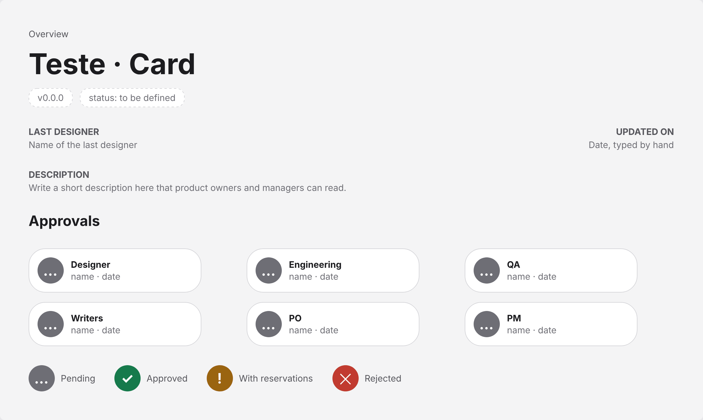
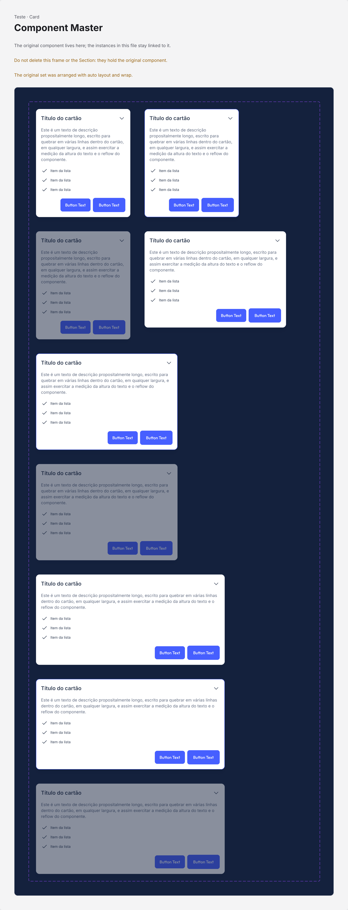
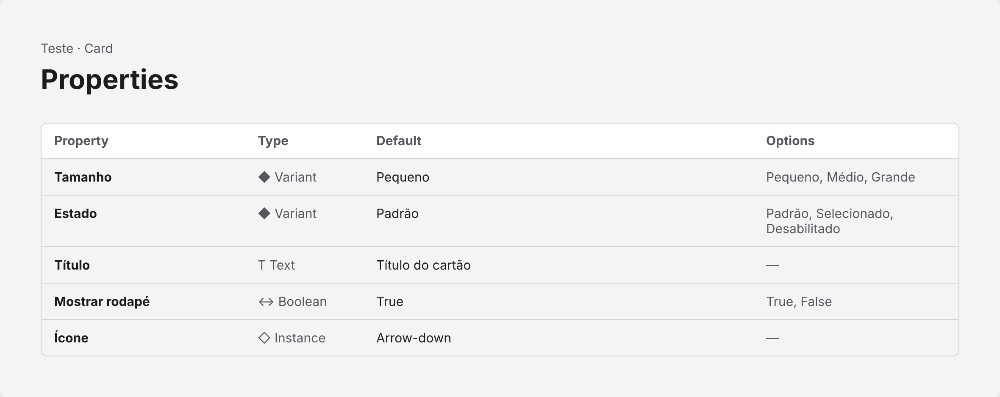
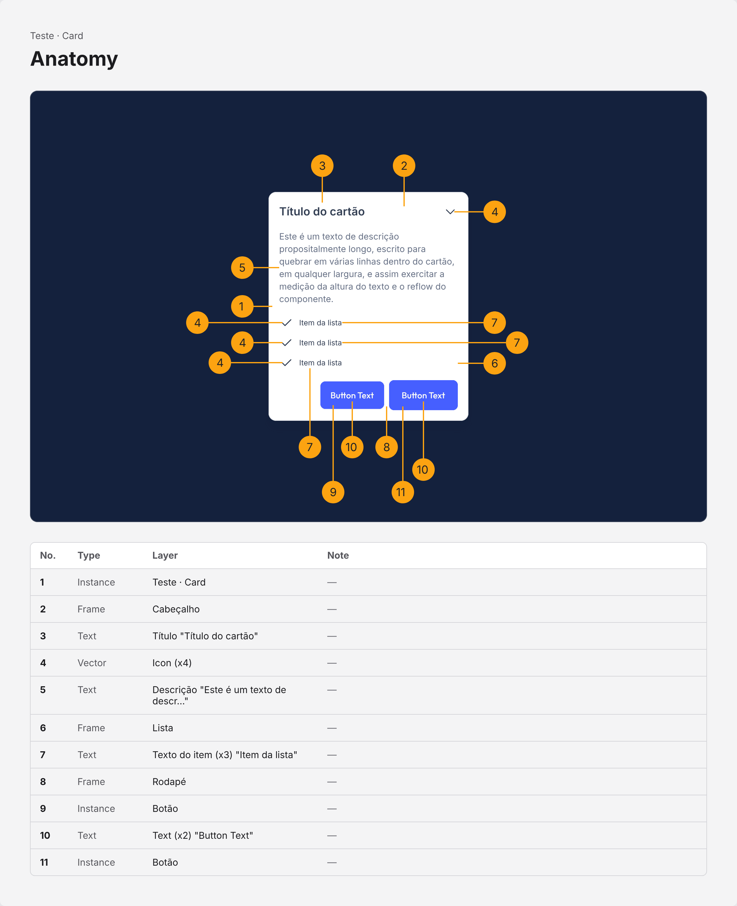
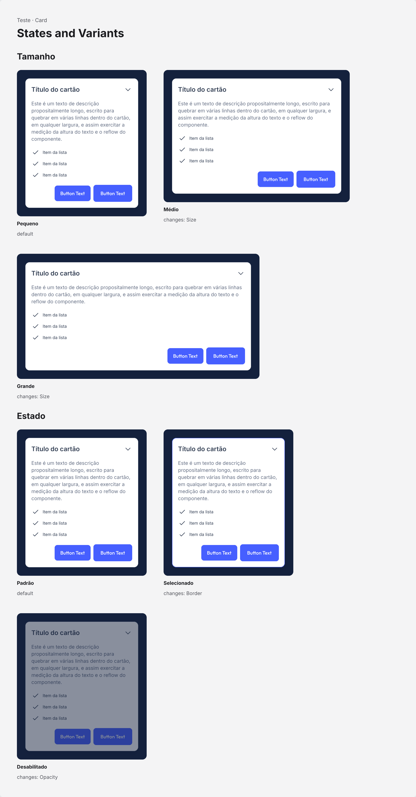
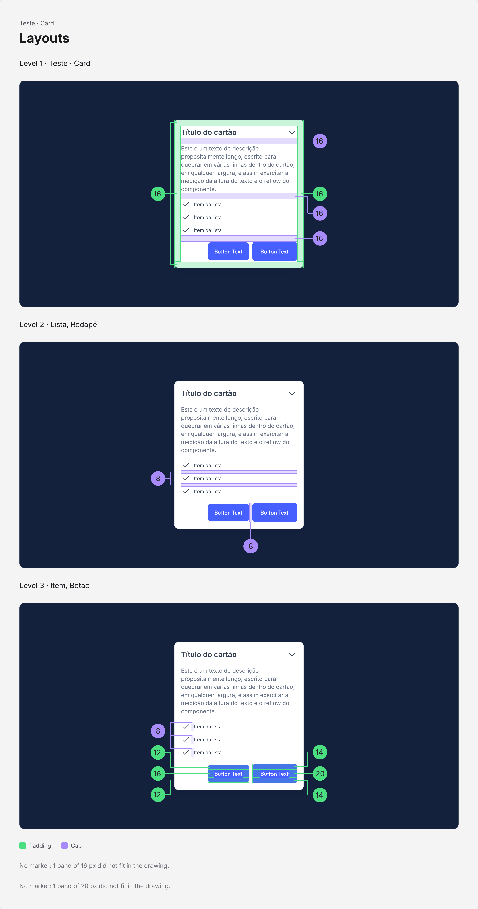

# Handoff Components

A plugin for FigCraft that documents the selected component, or component set, as handoff documentation on the same page: one **Section** with eight frames in a column.



The images in this README come from **a test component** ("Teste · Card", its content in Portuguese; the plugin's labels are in English) documented with the plugin.

> Handoff Components is an independent, community-made plugin for FigCraft. It is not affiliated with, endorsed by, or supported by the ArtCraft team. FigCraft and ArtCraft are names and trademarks of their respective owners.

## What it does

Select a component, a set or a variant and run one command. The plugin makes a **Section** for the component, to the right of everything on the page, with **eight frames in one column** (1180 px wide, 64 px apart):

1. **Cover**: the component's name, guides for version and status, last designer, date and description that you type over, and six **approval pills** (Designer, Engineering, QA, Writers, PO, PM) with a legend of the four states (pending, approved, with reservations, rejected). It is made once; a rerun never changes it.
2. **Component Master**: the original component or set **moves into this frame**, so the instances elsewhere in your file stay linked to it. A set wider than the frame is arranged with **auto layout and wrap**, and only when it does not fit; a set that fits is left as you made it. It is made again on every run.

   

3. **Properties**: name, type, default and options of each property.

   

4. **Anatomy**: the instance with numbered markers on **straight guides** (horizontal or vertical) that cross no text, and a table of the numbers (No., Type, Layer, Note). A number that has no room is said in the Note column.

   

5. **States and Variants**: a gallery with one tile for each option of each variant axis, holding a real instance, the option's name and a line that says `default` or `changes: Fill, Border, …` (the names of what changes, never the values). The default option is always there; a budget limits how many tiles are drawn, and the options left out are counted under their axis.

   

6. **Layouts**: the padding and the gap drawn as **translucent bands** over the instance (padding green, gap violet), **one drawing for each level of nesting** (up to four, each titled "Level N · layer names") and the value as a number. Equal bands share one number, tied to them by a vertical line and short traces on each side of the instance; a number never covers text, vectors or icons.

   

7. **Tokens**: two tables, the tokens of each layer (colors, measures, styles) and every color token with its value in the Dark and Light modes.
8. **Changelog**: a table (Version, Date, Change) with a row of guides that you write over. It is made once; a rerun never changes it.

A **Support frame**, outside the Sections, holds the **set of approval pills** (`.Handoff · Approval`) that every Cover uses. Do not delete it: if you do, a Cover that is made again makes it again.

Each new Section (a New Section too) gets one export setting on the Section itself, SVG at 1x with no suffix; the frames inside have none, and a rerun does not add it again. The stage behind the instances is light, mid-grey or dark; in **Auto** the plugin picks the one with the best contrast against the colors of the variants (see [`docs/stage-auto.md`](docs/stage-auto.md)). The colors of the Anatomy's markers and guides and of the Layouts' bands and numbers are fixed, not settings: each has one set for a light stage and one for a dark one (the Anatomy's markers use the dark set on the mid-grey stage too; the Layouts' bands use the light set there).

## Requirements

- FigCraft, [a design app from the ArtCraft team](https://getartcraft.com/apps/figcraft), and `figcraft-cli` on the PATH, with a FigCraft that supports **plugin API 2**.
- Tested with **figcraft-cli 0.18.1**. The plugin SDK is `figcraft-plugin-sdk` at tag `v0.14.0`.
- Only to build the plugin: Rust 1.95 (`rust-version = "1.95"` in `Cargo.toml`) with the `wasm32-unknown-unknown` target,
  for example with rustup:

  ```sh
  rustup toolchain install 1.95
  rustup override set 1.95          # run inside this repository
  rustup target add wasm32-unknown-unknown
  ```

  The build downloads the SDK from GitHub (a git dependency) and the other crates from crates.io.
- Python 3, only for the regression net.

## Install and build

```sh
scripts/build.sh
```

It writes `dist/` and prints the absolute path of the manifest to import. In FigCraft:
**Plugins ▸ Development ▸ Import plugin from manifest…** (in the Portuguese app: **Plugins ▸ Desenvolvimento ▸ Importar plugin a partir do manifesto…**), pick `dist/figcraft-plugin.json`.

**Permissions.** The manifest asks for `write` access and **28 host commands**. Seven of them are new in 0.11.0 and are there to make the Section and the approval pills: `node.create` (the Section), `component.create`, `component.combineVariants`, `component.addProperty` and `component.bindProperty` (the approval pills as a real component with two text properties), `instance.create` (the pills on the Covers) and `instance.setProperties` (the area written on each pill).

To make the release zip, run `scripts/package.sh`: it builds, then writes `dist/handoff-components-<version>.zip` (the manifest, the `.wasm`, `LICENSE` and `THIRD_PARTY_NOTICES.md` at the root, with fixed timestamps so the same build gives the same zip) and prints its SHA-256; it does not tag or publish anything.

The changes of each version are in [`CHANGELOG.md`](CHANGELOG.md); the data the plugin stores and returns is in [`docs/data-contract.md`](docs/data-contract.md).

## Usage

Run **Plugins ▸ Handoff Components ▸ Generate documentation…**. It opens a panel, "Handoff Components: Generate documentation", that stays open until you close it. It has eleven controls:

- **THIS PAGE**, saved on the current page: **Language** (English or Português (Brasil)) and **Stage** (Auto, Light or Dark; Auto is the default). Mid-grey is reached only by Auto.
- **UPDATE**, with the note "Applies to a Section that already exists; the first time, every frame is made. The Master is always remade.": the **Update** choice says which frames a rerun replaces. It has seven options: **All sections**, **Tables only**, **Tokens only**, **Properties only**, **Anatomy only**, **States and variants only** and **Layouts only**. It is not remembered: it is All each time the panel opens.

  | Update option | Frames it replaces (the Component Master is always made again; Cover and Changelog never) |
  |---|---|
  | **All sections** | Properties, Anatomy, States and Variants, Layouts, Tokens |
  | **Tables only** | Properties, Anatomy, States and Variants, Layouts (not Tokens) |
  | **Tokens only** | Tokens |
  | **Properties only** | Properties |
  | **Anatomy only** | Anatomy |
  | **States and variants only** | States and Variants |
  | **Layouts only** | Layouts |

- Four buttons: **Generate**, **New Section**, **Restore defaults** and **Close**, and below them a message about what happened the last time. The buttons come after the fields, on purpose: the app hands a panel's events to the plugin in the order of its controls.

**Generate** works on whatever is selected **at the moment of the click**: a component, a component set, a variant, or an instance. It refuses, with a note and without touching the file, when nothing is selected or the first selected layer is not a component, a set, a variant or an instance. Otherwise it saves the page's settings that you changed, makes or updates the documentation, takes the screen to the start of the Section and selects the component (it lives in the Component Master now). If something fails on the way, the app puts everything back as it was and shows the error. **Restore defaults** puts Language, Stage and Update in the panel back to their defaults; Language and Stage are then saved with the next documentation, and Update is never saved (it is All each time the panel opens); **Close** closes the panel. The panel is in the page's language and redraws at once when you change it.

**What a run does when the Section already exists**

- **Update.** Only the frames the Update choice names are replaced (and the Component Master, which is always made again). **Cover and Changelog are never replaced**, by any option; they come back only if you deleted them.
- **A frame you deleted by hand** (not the Cover or the Changelog) is made again, in its place, when Update names it; the frames under it move so that the gap stays 64 px. When Update does not name it, it stays gone and the panel says it was not made.
- **A Cover you deleted** is made again together with the Support frame if that one is gone too, with its pills.
- **A variant selected** documents the **whole set**, as if you had selected the set. A Section made for that variant by an earlier build is reused and re-marked, not duplicated.
- **New Section** makes another Section for the same component beside the first, with every frame but the Component Master. It follows the Stage setting.
- **A language switch** replaces the frames Update names, and the Master, in the new language; the Cover and the Changelog stay in the language they were made in.

**Warnings.** A run can raise these warnings; the panel shows **one** at a time (a frame that was not made comes before the rest):

| Code | What it tells you |
|---|---|
| `table_failed` | A section could not be made: see its frame. |
| `no_stage` | No stage suits every variant: change it in Stage. |
| `reflow_failed` | The set could not be arranged in lines: the Master was made as wide as it. |
| `wide_master` | A very wide component: every frame was made wider. |
| `legacy_doc` | A 0.10.0 documentation was found and left as it was. |
| `approval_property_missing` | The approval pills have no Area property: the Cover was made without the areas. |
| `support_missing` | The support frame could not be made: the Cover was made without approval pills. |
| `frame_missing` | A frame is missing and Update does not name it, so it was not made. |
| `markers_dropped` | Some Anatomy markers did not fit in the drawing; see the Note column. |
| `spacing_dropped` | Some spacing bands did not fit in the Layouts drawing; see the note in that frame. |

**Scripts** make the documentation with no panel by passing `direct: true` (the menu sends no parameters, and opens the panel): `plugin.run` with the `generate` command and the parameters `direct`, and optionally `lang` and `stage` (they set the page's settings: an empty one keeps what is saved, `-` clears it, anything else is checked, with the same messages as the panel), `update` (one of the seven options' keys: `all`, `tables`, `tokens`, `properties`, `anatomy`, `variants`, `layouts`) and `new_section`. `on_rerun`, `version` and `status` are still accepted and **ignored**. The selection is the one at the time of the call. This is what `scripts/regress.sh` uses. The answer is a JSON object (`section`, `frames`, `warnings`, `master`, `anatomy`, `gallery`, `spacing`, `tokens`, `support`, …) described in [`docs/data-contract.md`](docs/data-contract.md).

### The documentation's date, and what older versions saved

The documentation does not show a generation date; the Cover has a guide for you to type one. The plugin ignores, and does not erase, what earlier versions saved: a `tz`, a `fill` colour, a `line` colour and a `fill_opacity` on the page, and a `handoff-meta` sheet on each component. **Restore defaults** also drops, when the next documentation is generated, every key on the page that the plugin ignores.

## Demo

[`demo/`](demo/README.md) holds the **DS Base Demo**: a small neutral design system built from scratch
(Icon, Button, Card, Accordion, Code), with variables, styles and Light/Dark modes. Open
`demo/ds-base-demo.figcraft` and generate documentation for it.

## Known limitations

- Version 0.x, before 1.0: expect rough edges.
- **Translucent bands over colored components.** The Layouts bands are translucent, so over a colored component (a blue button, say) they change its color.
- The **Layouts frame is tall** when the instance is tall (one drawing for each level of nesting).
- **Small instances stay small.** The host cannot scale an instance whole, so the drawings are at 1x.
- The panel shows **one warning at a time**, even when a run has several.
- `on_rerun`, `version` and `status` are **accepted and ignored** in a direct run.
- Spacing bands that do not fit the drawing are not drawn; the note under the drawing says how many.
- The documentation is available in English (the default) and Brazilian Portuguese (`pt-BR`), chosen per page in the panel. The item in the Plugins menu stays in English (the host takes its label from the manifest); the values the panel saves stay in English (`light`, `dark`, `auto`).
- **How it was tested.** The measurements and the fuel in this repository come from `figcraft-cli 0.18.1` without a window (synthetic).

## Tests and regression

```sh
cargo test                      # unit tests + 4 that keep English text out of the code
scripts/regress.sh              # the public cases against tests/baseline.json: fixtures and the DS Base Demo in English and pt-BR, and the cases of the Cover, the Support frame, the Master and the corrections
scripts/regress.sh --private    # extra cases on files kept out of the repository (tests/private/), if present
scripts/panel_sequence.py       # the panel driven like the app does: the language, Update, New Section, the button, in one click; refusals; direct mode
```

`scripts/regress.sh --update [text]` rewrites the baseline for the cases whose name contains `text` (all, if omitted).
The demo components are found by name on every run. The `--private` option only works on a machine that has a local
`tests/private/` folder; without it, it says so and exits.

## Texts and languages

Every text the plugin shows lives in `locales/en.json` and `locales/pt-BR.json` (a flat `"Key": "text"` object each; `docs/i18n-strings.md`
lists both side by side). They are embedded in the `.wasm`; a key missing from `pt-BR.json` falls back to English. `cargo test` checks that
`pt-BR.json` has every key of `en.json`, with the same `{placeholders}`, and `tests/english_literals.rs` fails on English text written
in the code outside the dictionary (exceptions, each with its reason, are in `tests/literals-allow.txt`).

## License

MIT, see [LICENSE](LICENSE). The demo bundles Phosphor Icons path data and names the Inter and JetBrains Mono fonts, and the
plugin is built from Rust crates with their own licences; their notices are in [THIRD_PARTY_NOTICES.md](THIRD_PARTY_NOTICES.md).

## Credits

Built with Claude Code (Anthropic).
