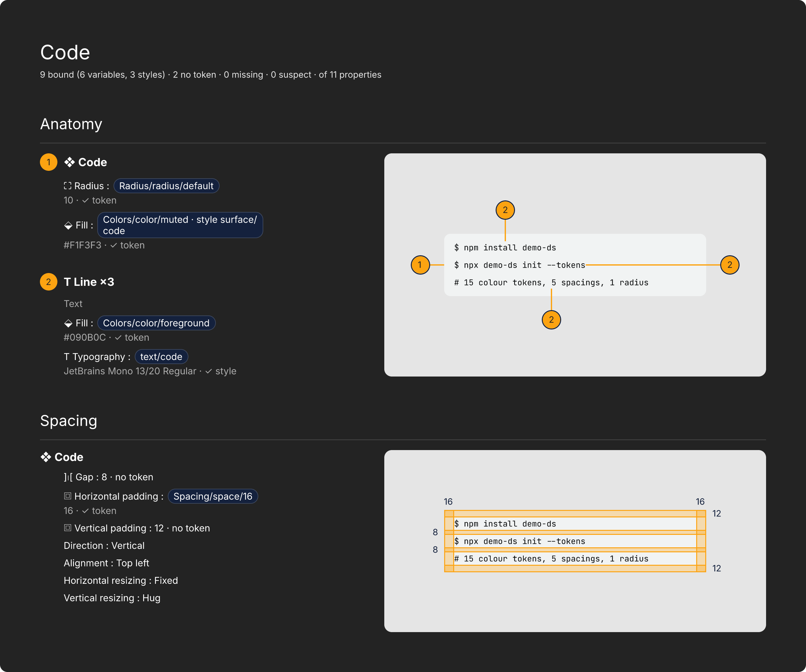

# Handoff Components

A plugin for FigCraft that documents the selected component, or component set, as handoff documentation on the same page.



> Handoff Components is an independent, community-made plugin for FigCraft. It is not affiliated with, endorsed by, or supported by the ArtCraft team. FigCraft and ArtCraft are names and trademarks of their respective owners.

## What it does

Select a component or a set and run one command. The plugin writes the documentation next to your work, with:

- **Anatomy**: the layers of the component, numbered, with their properties and tokens. Each property is audited:
  bound to a variable or style, loose ("no token"), missing from the file, or suspect (bound, but to something of
  another value).
- **Spacing**: gap and padding, drawn over the component, with the measures filled at 30% opacity.
- **Variant differences**: for a component set, what each variant changes from the default one, axis by axis. Each axis is a section named after the property (`Type`, `Size`…), with a **block** for each option: its title is only the option's value (`Secondary`, `Large`; the layer keeps the variant's full name, `Variant: Type=Secondary, Size=Medium, State=Enabled`), the changes are on the left and a new instance of the variant is on the right, on its own stage. The default option says "Default" and nothing else. Combinations that don't exist are listed at the end of the section (`Not defined: Large`).
  - **A change of a property** that has a token or a colour is stacked: the label in bold (`Fill:`), a line of tokens (chips, as in the Anatomy; a side with no token shows a dim `—`) and, under it, a line of values, with the old side, an arrow and the new side lined up in columns. A colour has a 16 px square and its hex; a colour with an alpha gets an empty square and the alpha is in the hex; a gradient or an image shows only its kind; a fill or stroke that is not there says `none`. A change with no token and no colour (a stroke weight, an opacity, a text's own typography) is one line, `Label: from → to` (the label and its colon in bold, the rest as it is), and so is one whose values do not fit the block.
  - **Stripes tell the blocks of a list apart.** A block is a group's title (`↳ Leading icon / plus · Label / Text`) together with the first change under it, or one line on its own (a change of the component itself, a layer shown or hidden, an instance swapped). Every block has the same padding (8 px) and the blocks are 4 px apart; every other block (the 2nd, the 4th…, never the first) has a `#4C4C4C` fill with rounded corners (radius 12). A group's title is in bold and the secondary text colour (`#E5E5E5B3`, `#E5E5E5` on a stripe); in a layer shown, hidden or swapped the title (`↳ Content / Features:`) is in bold in the same colour and the state (`hidden`, `Size: 16 → 20`) as it is.
  - **Hugging or filling is not a difference.** A component that hugs (or fills) has the width and height its padding and content give it, and those have their own lines, so its width and height are listed only when the mode is fixed or when the mode changes (`Width: Hug → Fixed 320`). A component the host gives no sizing for (an icon) counts as fixed.
  - **At most 400 nodes per run** are spent on the stacked format. When the next change does not fit, it and the ones after it are drawn as one line of text, and a note at the end of the section says how many (`3 changes are shown on one line`).
- **A fixed palette**: the lines, markers and measures use fixed colours, by stage and by section (there is no colour setting). On the light stage the Anatomy is `#C54600` and the Spacing `#007D00`; on the dark stage they are `#FCA311` and `#4ADE80`. The number inside a marker is white on the light stage and dark (`#232323`) on the dark one.
- **A stage that fits the effects**: every picture sits on a stage (`#E5E5E5` light, `#14213D` dark, rounded and clipped). The stage grows when the instance has a shadow or a blur that would be cut by the clip, by up to 400 px per side.
- **One SVG export**: the documentation frame is born with a single export setting, SVG at 1x with no suffix, whatever its height (a PNG fails above 16,384 px; SVG has no such limit). The SVG draws text as outlines and its files are big: about 2.6 MB for the DS Base Demo's Card and about 7.3 MB for the 25,897 px test case (measured with figcraft-cli 0.18.1).
- **Same page, one click**: a new documentation goes 512 px to the right of the rightmost edge of everything on the page, with its top at y = 0 (not at the height of anything; measured on the DS Base Demo: the page's content ends at x = 3,040, the first documentation is at x = 3,552, and the next one starts 512 px after the end of that). When it replaces the most recent earlier documentation of the same component, it takes that one's place instead. (Inside the file the frame keeps the old pluginData key `handoff-report`, so a rerun still replaces documentation made by earlier versions.)

More samples: [Button](docs/samples/report-button.png), [Card](docs/samples/report-card.png),
[Accordion](docs/samples/report-accordion.png).

## Requirements

- FigCraft, [a design app from the ArtCraft team](https://getartcraft.com/apps/figcraft), and `figcraft-cli` on the PATH.
- Tested with **figcraft-cli 0.18.1**. The plugin SDK is `figcraft-plugin-sdk` at tag `v0.14.0`.
- Only to build the plugin: Rust 1.95 (`rust-version = "1.95"` in `Cargo.toml`) with the `wasm32-unknown-unknown` target,
  for example with rustup:

  ```sh
  rustup toolchain install 1.95
  rustup override set 1.95          # run inside this repository
  rustup target add wasm32-unknown-unknown
  ```

  The build downloads the SDK from GitHub (a git dependency) and the other crates from crates.io.
- Python 3, only for the regression net.

## Install and build

```sh
scripts/build.sh
```

It writes `dist/` (the `.wasm` is about 479 KB) and prints the absolute path of the manifest to import. The manifest asks for `write` access and 21 commands. In FigCraft:
**Plugins ▸ Development ▸ Import plugin from manifest…** (in the Portuguese app: **Plugins ▸ Desenvolvimento ▸ Importar plugin a partir do manifesto…**), pick `dist/figcraft-plugin.json`.

To make the release zip, run `scripts/package.sh`: it builds, then writes `dist/handoff-components-<version>.zip` (the manifest, the `.wasm`, `LICENSE` and `THIRD_PARTY_NOTICES.md` at the root, with fixed timestamps so the same build gives the same zip) and prints its SHA-256; it does not tag or publish anything.

The changes of each version are in [`CHANGELOG.md`](CHANGELOG.md); the data the plugin stores and returns is in [`docs/data-contract.md`](docs/data-contract.md).

## Usage

Run **Plugins ▸ Handoff Components ▸ Generate documentation…**. It opens a panel (it needs a FigCraft that supports plugin API 2) that stays open until you close it:

- **This page**, saved on the current page: language (English or Português (Brasil)), stage (light, dark or **auto**, the default) and what a rerun does (replace or new). The panel has 17 controls: 5 editable fields (the selects Language, Stage and On rerun, and the text fields Version and Status), 3 buttons (Generate documentation, Restore defaults, Close) and 9 notes (the titles, the hint, the message, the freeze warning and the empty ones that make room). In **auto**, each picture of the documentation (the Anatomy and every variant row) gets the stage, light or dark, that has the better contrast with the colours of the component, judged against `#E5E5E5` and `#14213D`; the Spacing follows the Anatomy (see [`docs/stage-auto.md`](docs/stage-auto.md)).
- **Documentation**: **Version** and **Status**. Left blank, the documentation shows “to be defined” (“a definir” in Portuguese): the header always has the line `Version: … · Status: …`. Nothing is remembered: after a documentation is made, both fields are blank again.
- **Messages**, below the buttons (so the buttons never move when a message is longer or shorter): what happened the last time (`✔` done, `✖` refused) and a fixed warning (`ℹ`) that the screen freezes while the documentation is generated. The buttons come after all the fields, on purpose: the app hands a panel's events to the plugin in the order of its controls, so a button above a field would run before the field's new value arrived.

**Generate documentation** works on whatever is selected **at the moment of the click**: a component, a component set (it shows the set's own default variant, else the first one) or a variant. Then it:

1. refuses, with a note and without touching the file, when nothing is selected, or the selection is not a component, a set or a variant;
2. saves the page's settings as the panel shows them (only what you changed is written);
3. makes the documentation, as one undo step;
4. takes the screen to the **start** of the documentation, as wide as the screen allows (zoom 100% at most);
5. gives the selection back (what was selected before the click stays selected);
6. empties Version and Status.

If something fails on the way, the app puts everything back as it was and shows the error. **Restore defaults** puts stage and “on rerun” back to the defaults and **keeps the language** (they are saved with the next documentation, and old keys the plugin ignores are dropped then); **Close** closes the panel. The panel is in the page's language and redraws at once when you change it, keeping what you typed.

The defaults are: language English; stage `auto`; on rerun `replace`.

**Scripts** make the documentation with no panel by passing `direct: true` (the menu sends no parameters, and opens the panel): `plugin.run` with the `generate` command and the parameters `direct`, and optionally `lang`, `stage`, `on_rerun` (they set the page's settings: an empty one keeps what is saved, `-` clears it, anything else is checked, with the same messages as the panel) and `version`, `status` (the header's texts; absent means “to be defined”). The selection is the one at the time of the call. This is what `scripts/regress.sh` uses. The parameters `line` and `fill_opacity` of earlier versions are ignored, with no error.

The run returns a JSON object. Among its fields: `settings.palette` (`{anatomy, spacing}`, the two colours of the stage that was used), `settings.fill` (the measures' fill: the Spacing colour at 30%, `#007D004D` on the light stage and `#4ADE804D` on the dark one), `export` (`{format: "svg", size: "1x", result, frame_height}`) and `effects` (`{reach, cap, slack, narrow}`: how far the instance's effects reach, in px, the 400 px cap, the 8 px of room kept, and the rows whose stage is too narrow for their effects; the stage is not made wider) and, for a set, `axes.stacked` (`{limit, used, capped, measured, redrawn}`: the 400-node budget of the stacked format, the nodes spent, the changes the budget left as one line, the stacked changes measured against the legend's width, and the ones that did not fit and were drawn again).

### The documentation's date, and what older versions saved

The documentation does not show a generation date. The plugin host gives a plugin only the instant in UTC, with no time zone and
no local time, so a date would be wrong for many people; it will come back when the plugin API offers a clock.

- **Old files.** Earlier versions saved a `tz` (time zone), a `fill` colour, a `line` colour and a `fill_opacity` on the page, and a `handoff-meta` sheet on each component (version, status, default variant, and a typed `date` before 0.9.6). The plugin ignores them and does not erase them: they stay in the file as they were. **Restore defaults** removes the page's keys that the plugin ignores, `tz`, `line` and `fill_opacity` included.

## Demo

[`demo/`](demo/README.md) holds the **DS Base Demo**: a small neutral design system built from scratch
(Icon, Button, Card, Accordion, Code), with variables, styles and Light/Dark modes. Open
`demo/ds-base-demo.figcraft` and generate documentation for it.

## Known limitations

- Version 0.10.x, before 1.0: expect rough edges.
- The documentation is available in English (the default) and Brazilian Portuguese (`pt-BR`), chosen per page in the panel. The item in the Plugins menu stays in English (the host takes its label from the manifest); the panel itself follows the page's language, and the values it saves stay in English (`light`, `dark`, `auto`, `replace`, `new`). In `pt-BR`, a few words are still English because no translation has been agreed: the type of a variable in a token conflict (`number`, `color`…); the name of an effect the plugin doesn't describe (noise, texture, glass); and the technical reasons the host gives in an error.
- The host does not report a layer's text case, so it is missing from the typography lines.
- The screen freezes while the documentation is generated (it is made inside the click, in the app's own thread, with no progress indicator).
- A run, and each click in the panel, has a fixed instruction budget (1,000,000,000 by default in the FigCraft v0.14.0 sources). Very large components can
  use much of it: the heaviest case in the regression net, a test fixture with a 155-layer component, uses about 65%; the DS Base
  Demo's Card uses about 25% and its Button about 22% (measured with figcraft-cli 0.18.1).
- Swapping an instance for another component between variants is listed as one line, `↳ Trigger / Chevron: Name: caret-up → caret-down` (only the variant properties that change; both names as they are when they are not variant names of the same properties), and what is inside the instance is not listed. A layer that is hidden in one variant and shown in another (an icon that is not an instance, or an instance that is only turned on or off) is still listed as visible / hidden.
- Long text changes are shown as an excerpt of at most 70 characters around the first difference, cut at a word boundary, with `[…]` where text was left out. A change in spaces or line breaks only has a line of its own (`Text: whitespace or line breaks only`). Identical changes in several layers are grouped under one title (`↳ A · B · C +2`; in `pt-BR`, `↳ A, B, C +2`; at most 3 names). A variant lists at most 12 lines (titles included); the rest is counted (`+2 more differences`). A change drawn on one line, and every other line of a property, is `Label: value` (`Label: from → to`), in both languages; a stacked change has its label in bold with a colon (`Fill:`). A layer's or a paint's opacity is shown to one decimal; the alpha of an effect's colour, in whole percent.
- The picture of a variant is an instance of that variant placed by the host (`instance.place`), and the differences are read from it. When a layer inside the variant is bound to an instance-swap property of the set, the host gives the instance that property's default instead of the component the variant holds in that layer (measured on the DS Base Demo: the Button's Large variant holds `Name=plus, Size=20` in its leading icon, and its instance has `Size=16`, so the picture is 4 px narrower and the icon's size change is not listed).
- Layer rotation is not audited or compared between variants.
- The app's Arrow is a Line with an arrowhead (the host reports it as a `LINE`), so the documentation calls it Line (Linha in pt-BR), not Arrow.

## Tests and regression

```sh
cargo test                      # 190 unit tests + 4 that keep English text out of the code
scripts/regress.sh              # 14 cases against tests/baseline.json: 9 in English (4 fixtures + 5 on the DS Base Demo) and 5 in pt-BR
scripts/regress.sh --private    # 5 extra cases (in English) on files kept out of the repository (tests/private/), if present
scripts/panel_sequence.py       # the panel driven like the app does: Version and Status, then the button, in one click; refusals; direct mode
```

`scripts/regress.sh --update [text]` rewrites the baseline for the cases whose name contains `text` (all, if omitted).
The demo components are found by name on every run. The `--private` option only works on a machine that has a local
`tests/private/` folder; without it, it says so and exits.

## Texts and languages

Every text the plugin shows lives in `locales/en.json` and `locales/pt-BR.json` (a flat `"Key": "text"` object each; `docs/i18n-strings.md`
lists both side by side). They are embedded in the `.wasm`; a key missing from `pt-BR.json` falls back to English. `cargo test` checks that
`pt-BR.json` has every key of `en.json`, with the same `{placeholders}`, and `tests/english_literals.rs` fails on English text written
in the code outside the dictionary (exceptions, each with its reason, are in `tests/literals-allow.txt`).

## License

MIT, see [LICENSE](LICENSE). The demo bundles Phosphor Icons path data and names the Inter and JetBrains Mono fonts, and the
plugin is built from Rust crates with their own licences; their notices are in [THIRD_PARTY_NOTICES.md](THIRD_PARTY_NOTICES.md).

## Credits

Built with Claude Code (Anthropic).
